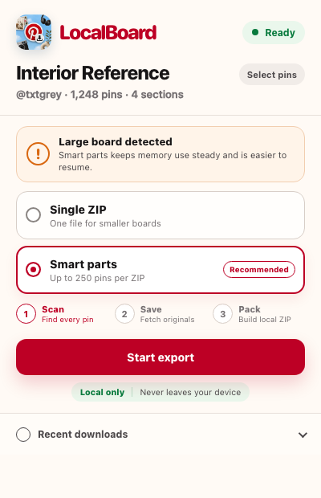
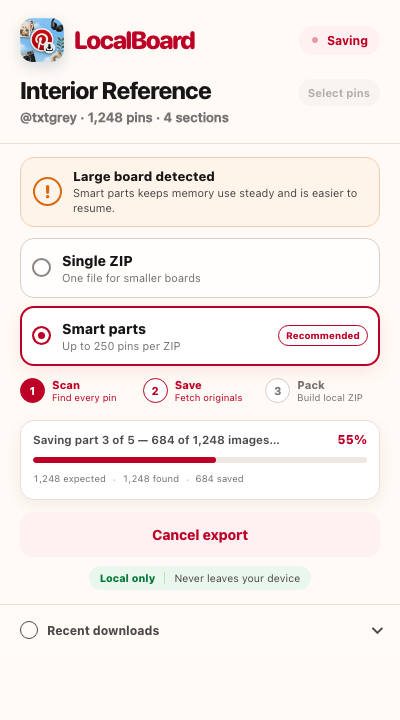

<p align="center">
  
</p>

<h1 align="center">Pinterest LocalBoard</h1>

<p align="center">
  A clean Chrome extension that saves Pinterest boards locally in one ZIP or reliable memory-safe parts.
</p>

<p align="center">
  <a href="https://github.com/thetejasagrawal/Pinterest-LocalBoard/actions/workflows/validate.yml">
    
  </a>
  <a href="LICENSE">
    
  </a>
  
  <a href="https://github.com/thetejasagrawal/Pinterest-LocalBoard/releases/tag/v2.0.4">
    
  </a>
  
  <a href="https://chromewebstore.google.com/detail/pinterest-localboard/ffalngabgmaancacaigapmkkaoalaama">
    
  </a>
</p>

<p align="center">
  <a href="#quick-start"><strong>Quick Start</strong></a>
  ·
  <a href="#features"><strong>Features</strong></a>
  ·
  <a href="#installation"><strong>Installation</strong></a>
  ·
  <a href="#how-it-works"><strong>How It Works</strong></a>
  ·
  <a href="#chrome-web-store"><strong>Chrome Web Store</strong></a>
  ·
  <a href="#development"><strong>Development</strong></a>
</p>

> Built for a simple workflow: open a Pinterest board, click the extension,
> and export the board locally as one ZIP or memory-safe ZIP parts.

Pinterest LocalBoard is intentionally focused. It does not use a backend, it
does not upload your board data, and it does not try to be a Pinterest client.
It detects the current board page, gathers the highest-quality image URLs the
page exposes, downloads what it can, and packages the results locally. Large
boards automatically default to smaller ZIP parts so the browser does not need
to hold an entire 1,000+ pin archive in memory at once.

## What's New in v2.0.4

This release brings the v2 redesign and reliability work to GitHub: the new
LocalBoard icon, a warm cream popup, Single ZIP and Smart parts export modes,
seven-day resume checkpoints, and verified ZIP completion. Scanning and pin
selection now exclude Pinterest's recommendation feed, and cancellation works
through image fetching, ZIP packing, and download verification.

<p align="center">
  
  
</p>

See the [changelog](CHANGELOG.md) for the full history and the
[v2.0.4 release](https://github.com/thetejasagrawal/Pinterest-LocalBoard/releases/tag/v2.0.4)
for the installable ZIP. The Chrome Web Store has a separate release process.

## Quick Start

1. Install from the
   [Chrome Web Store](https://chromewebstore.google.com/detail/pinterest-localboard/ffalngabgmaancacaigapmkkaoalaama).
2. Open a Pinterest board your current session can access.
3. Click `Pinterest LocalBoard`, choose `Single ZIP` or `Smart parts`, and press `Start export`.

## Features

| Area | What it does |
| --- | --- |
| Board detection | Detects Pinterest board pages from the active tab and re-checks when Pinterest changes the URL without a full page reload. |
| Full-quality image capture | Prefers the best `i.pinimg.com` image candidate available, including `originals` when Pinterest exposes it. |
| Signed-in board support | Works with public boards and private boards your current Pinterest session can view. |
| Flexible ZIP export | Saves smaller boards as one ZIP or splits large boards into memory-safe 250-pin ZIP parts. |
| Large-board scanning | Waits through slow Pinterest loading, nudges stalled feeds, and continues scanning instead of stopping after a short pause. |
| Resume checkpoints | Continues an interrupted Smart-parts run from the next unfinished ZIP part for up to seven days. |
| Pin selection | Exports selected board pins and keeps recommendation cards out of the selection. |
| Verified downloads | Confirms each generated ZIP finishes in Chrome before advancing its resume checkpoint. |
| Recovery-aware workflow | Retries image downloads, tolerates partial failures, and still completes the ZIP when possible. |
| Failure reporting | Writes `_download_report.json` into the ZIP with scan details and failed items. |
| Local history | Stores recent downloads in `chrome.storage.local` with board name, ZIP name, counts, and timestamps. |
| Clean popup UI | Includes board info, live progress, quick actions, cancel support, and recent downloads. |

## Why This Exists

- Saving a board image-by-image is slow and tedious.
- Pinterest changes pages like a single-page app, so a downloader needs to
  handle stale detection cleanly.
- Large boards fail badly when one broken asset aborts the whole job.
- Many users want a local export flow without a remote service.

Pinterest LocalBoard is designed to be practical first: local-only, explicit,
and resilient enough for real use.

## Installation

### Recommended

Install from the Chrome Web Store:

**[Install Pinterest LocalBoard](https://chromewebstore.google.com/detail/pinterest-localboard/ffalngabgmaancacaigapmkkaoalaama)**

### Download From GitHub

Prefer GitHub if you want to inspect the extension files or install a specific
release manually:

1. Download the latest ZIP from
   [GitHub Releases](https://github.com/thetejasagrawal/Pinterest-LocalBoard/releases/latest).
2. Unzip the file.
3. Open `chrome://extensions` in Chrome.
4. Enable `Developer mode`.
5. Click `Load unpacked`.
6. Select the unzipped folder.

Direct ZIP for this release:
[`pinterest-localboard-v2.0.4-chrome-web-store.zip`](https://github.com/thetejasagrawal/Pinterest-LocalBoard/releases/download/v2.0.4/pinterest-localboard-v2.0.4-chrome-web-store.zip)

### Load From Source

1. Open Chrome.
2. Go to `chrome://extensions`.
3. Turn on `Developer mode`.
4. Click `Load unpacked`.
5. Choose the [`extension/`](extension) directory from this repository.

### After Updates

1. Go back to `chrome://extensions`.
2. Click `Reload` on Pinterest LocalBoard.
3. Refresh the Pinterest tab if board detection looks stale.

## Usage

1. Open a Pinterest board page.
2. Wait until the board content is visible.
3. Click the extension icon.
4. Confirm the popup shows the board name.
5. Choose `Single ZIP` or `Smart parts`, then click `Start export`.
6. Wait for the archive to finish downloading.

### Best Results

- Open the actual board feed, not an individual pin page.
- For private boards, make sure you are signed into the Pinterest account that
  can view the board before starting the download.
- If Pinterest is showing section tiles instead of pins, open `All Pins` or a
  specific section with visible pin tiles.
- For very large boards, give the page a moment to settle before starting.

## What You Get

Single-ZIP exports are named like:

```text
my_board_localboard_2026-04-09.zip
```

Smart-parts exports use numbered filenames so a large run is easy to verify and
resume:

```text
my_board_localboard_2026-08-19_part-1-of-5.zip
my_board_localboard_2026-08-19_part-2-of-5.zip
...
```

Inside the archive:

```text
My_Board/
├── 001_123456789_title.jpg
├── 002_987654321_title.webp
├── ...
└── _download_report.json
```

The report file includes:

- board name and URL
- scan totals
- downloaded and failed counts
- per-item failure details when some assets could not be fetched

## How It Works

| Part | File | Responsibility |
| --- | --- | --- |
| Popup UI | [`extension/popup.html`](extension/popup.html), [`extension/popup.css`](extension/popup.css), [`extension/popup.js`](extension/popup.js) | Detects the active tab, shows current board state, starts downloads, shows progress, and renders local history. |
| Content script | [`extension/content.js`](extension/content.js) | Detects board pages, watches Pinterest SPA navigation, scans pins, fetches image candidates, builds the ZIP, and writes history entries. |
| Background service worker | [`extension/background.js`](extension/background.js) | Verifies and cancels generated ZIP downloads, and reopens the popup from pin selection. |
| ZIP library | [`extension/vendor/jszip.min.js`](extension/vendor/jszip.min.js) | Generates the archive in-browser. |
| CI validation | [`.github/workflows/validate.yml`](.github/workflows/validate.yml) | Runs syntax and manifest validation on pushes and pull requests. |

### Reliability Notes

- Handles already-open Pinterest tabs by injecting the content script when
  needed.
- Clears stale board detection when the page URL changes.
- Waits for additional pins or page height growth while scanning.
- Continues the run when a subset of images fails.
- Records failed assets instead of silently dropping them.

## Permissions

### Extension Permissions

| Permission | Why it is needed |
| --- | --- |
| `activeTab` | Accesses the currently open tab when you trigger the extension. |
| `downloads` | Verifies generated ZIPs, and cancels the current generated ZIP when you press Cancel, before marking a Smart-parts checkpoint complete. |
| `scripting` | Injects the content script into already-open Pinterest tabs when necessary. |
| `storage` | Saves recent download history, the preferred export mode, and a temporary Smart-parts resume checkpoint locally in the browser. |

### Host Permissions

| Host pattern | Why it is needed |
| --- | --- |
| `https://pinterest.com/*` | Supports direct Pinterest navigation. |
| `https://*.pinterest.com/*` | Supports Pinterest subdomains and board pages. |
| `https://*.pinimg.com/*` | Fetches the actual image assets used in the ZIP. |

## Privacy

- No backend
- No analytics
- No external upload step
- Download history is stored locally in Chrome only
- The extension only works with content your current Pinterest session can access

## Limitations

- Pinterest LocalBoard can download private boards only when your signed-in
  Pinterest session can already view them.
- Pinterest LocalBoard does not bypass private-board permissions.
- It depends on Pinterest's current DOM and client-side data exposure.
- Large boards use Smart parts by default to keep browser memory use bounded.
  Chrome may ask once for permission to allow multiple downloads from Pinterest.
- Interrupted Smart-parts runs keep a local checkpoint for seven days and resume
  at the next unfinished ZIP part when the same board is exported again.
- If Pinterest stops exposing high-quality image URLs in the page, output
  quality may degrade until detection logic is updated.

## Troubleshooting

<details>
  <summary><strong>The popup says no board was found</strong></summary>

  <br>

  Make sure the active tab is a Pinterest board URL, reload the extension in
  `chrome://extensions`, then refresh the Pinterest tab once.
</details>

<details>
  <summary><strong>The extension finds too few images</strong></summary>

  <br>

  Scroll the board a little first, open the actual board feed instead of a
  board overview with sections only, and try a board with clearly visible pins.
</details>

<details>
  <summary><strong>The ZIP finishes with some failures</strong></summary>

  <br>

  Open `_download_report.json` inside the ZIP. The extension is designed to
  finish with partial success instead of failing the whole run when only some
  assets are unavailable.
</details>

<details>
  <summary><strong>History looks empty after an update</strong></summary>

  <br>

  Reload the extension once. Recent versions migrate older history entries to
  the new LocalBoard storage key automatically.
</details>

## Chrome Web Store

Pinterest LocalBoard is available on the Chrome Web Store — no developer mode required:

**[Install from the Chrome Web Store](https://chromewebstore.google.com/detail/pinterest-localboard/ffalngabgmaancacaigapmkkaoalaama)**

The repository also includes Chrome Web Store submission materials:

- listing copy: [`chrome-web-store/listing.md`](chrome-web-store/listing.md)
- upload checklist: [`chrome-web-store/checklist.md`](chrome-web-store/checklist.md)
- privacy policy: [`PRIVACY_POLICY.md`](PRIVACY_POLICY.md)
- support page: [`SUPPORT.md`](SUPPORT.md)
- package script: [`scripts/build-chrome-web-store-package.sh`](scripts/build-chrome-web-store-package.sh)
- store screenshots and promo assets: [`chrome-web-store/assets/`](chrome-web-store/assets)

Build the upload package with:

```bash
scripts/build-chrome-web-store-package.sh
```

## Development

There is no build step. The project is plain HTML, CSS, and JavaScript.

### Validate Locally

```bash
node --check extension/popup.js
node --check extension/background.js
node --check extension/content.js
python3 -m json.tool extension/manifest.json >/dev/null
scripts/build-chrome-web-store-package.sh
```

Run the browser regression fixtures with Chrome or Chromium installed:

```bash
python3 scripts/run-browser-regressions.py
```

The runner serves the fixtures locally and checks large-board exports, resume
checkpoints, cancellation, and recommendation filtering. It uses synthetic
boards and mocked image downloads; live Pinterest checks are still part of
the [release checklist](chrome-web-store/checklist.md).

### Project Layout

```text
.
├── .github/
├── CHANGELOG.md
├── CONTRIBUTING.md
├── LICENSE
├── README.md
├── SECURITY.md
├── logo.png
├── chrome-web-store/
├── qa/
├── scripts/
└── extension/
    ├── assets/
    ├── background.js
    ├── content.js
    ├── icons/
    ├── manifest.json
    ├── popup.css
    ├── popup.html
    ├── popup.js
    └── vendor/
```

For contribution and validation expectations, see
[`CONTRIBUTING.md`](CONTRIBUTING.md).

## Roadmap

- Stronger recovery for very large boards
- Moving more long-running export work out of the page
- Better reporting for skipped pins and selector mismatches

## License

MIT. See [`LICENSE`](LICENSE).

## Disclaimer

Pinterest LocalBoard is an independent project and is not affiliated with,
endorsed by, or sponsored by Pinterest.
